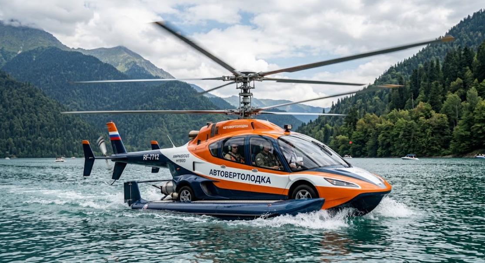

# Автовертолодка



Учебный проект по практике «Безумное средство передвижения» (БСБО-16-23, стихия: вода).

Автовертолодка — лодка, которая может выезжать на берег как автомобиль и подниматься в воздух как вертолёт. У неё три режима (`water`, `ground`, `air`), запас энергии, пройденный путь и корпус, который должен держать её массу на воде.

- ТЗ и тесты: Филиппов Даниил Викторович
- Реализация: Нечаева Софья Владимировна

## Требования

Python 3.8 или новее. Сторонние библиотеки не нужны.

## Как запустить тесты

Из корня проекта:

```
python -m unittest discover -s tests -v
```

Должно пройти 36 тестов.

## Пример использования

```python
from auto_helicopter_boat import AutoHelicopterBoat

boat = AutoHelicopterBoat("Амфибиус", mass_kg=500, hull_volume_m3=1, max_speed_kmh=100)

print(boat.move(10, "water"))      # 0.2 ч (энергия 90)
boat.switch_mode("ground")         # энергия 85
print(boat.move(20, "ground"))     # 0.25 ч (энергия 55)
print(boat.can_overcome("tree"))   # True
boat.switch_mode("air")            # энергия 45
print(boat.can_overcome("wall"))   # True
print(boat.get_status())
```

Ошибки: `ValueError` (неверные аргументы), `BoatWrongMode` (режим не совпадает со средой движения), `BoatSinks` (корпус не держит массу), `BoatOutOfEnergy` (не хватает энергии).

## Файлы проекта

| Файл | Что это |
|---|---|
| `SPEC.md` | Техническое задание (версия 1.0, заморожено 26.10.2026) |
| `TEST_CASES.md` | Таблица тест-кейсов |
| `tests/test_auto_helicopter_boat.py` | Тесты (`unittest`) |
| `auto_helicopter_boat.py` | Реализация |
| `REVIEW_*.md` | Ревью ТЗ |
| `RESPONSES.md` | Ответы автора на ревью |
| `CHANGELOG.md` | Журнал изменений после заморозки |
